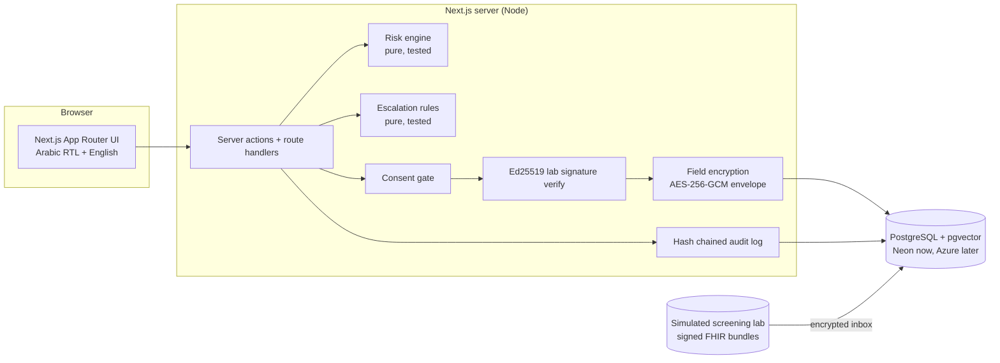
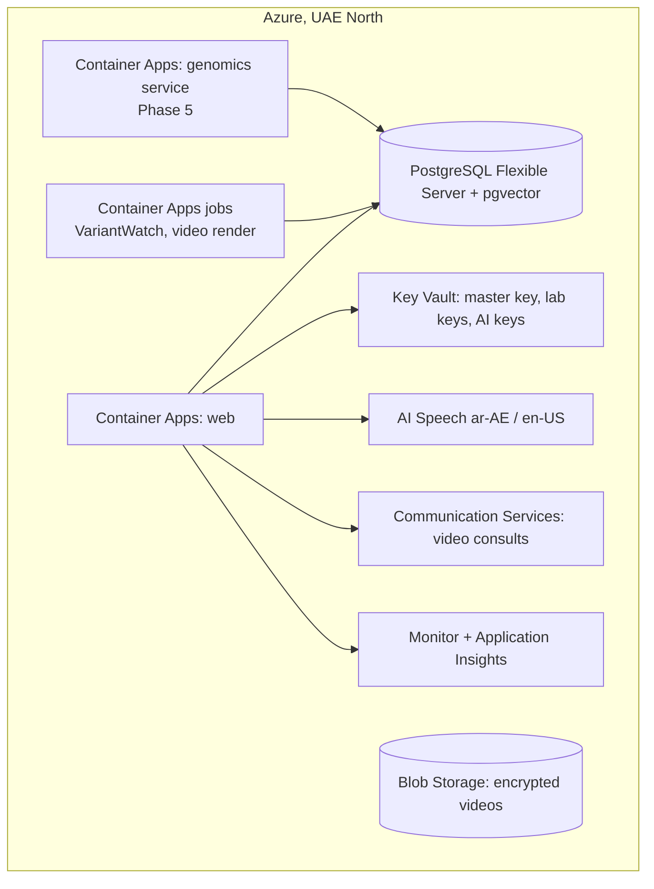
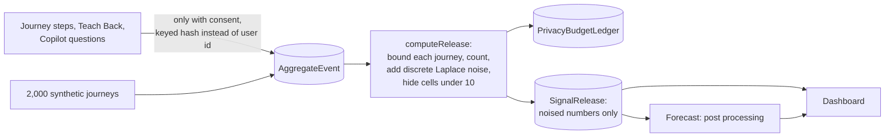

# Architecture

## Today (Phase 1)

* **Web app:** Next.js 15 (App Router), TypeScript strict, Tailwind v4 with the DESIGN.md token system, Motion, React Three Fiber (Living Helix, lazy loaded with a static fallback), next-intl (Arabic default, RTL).
* **Data:** Prisma 6 on PostgreSQL. Locally PostgreSQL 16 with pgvector in Docker Compose (Neon as a fallback); production Azure Database for PostgreSQL Flexible Server in UAE North. `pgvector` is enabled for Phase 2 retrieval.
* **Auth:** demo persona picker behind `DEMO_MODE` with an encrypted, httpOnly iron-session cookie. Production integration point: UAE Pass (OpenID Connect).
* **Result import:** the lab's signed FHIR style bundle waits in an encrypted inbox. On import the server verifies the Ed25519 signature against the lab public key **before** storing anything, then stores the canonical bundle encrypted with the person's data key. The signature is re verified each time the result is decrypted.
* **Blind Couple Match (Phase 2):** ECDH private set intersection over ristretto255 runs in each partner's browser (`lib/psi/protocol.ts`). The server (`lib/actions/psi.ts`) only relays fixed size sets of blinded points while both Dual Key consents are active, and the risk engine computes couple risk on the device.

## Target (later phases)

Infrastructure as code is in `infra/main.bicep` (registry, Container Apps web app, migrate job, nightly VariantWatch job, PostgreSQL with pgvector, Key Vault, AI Speech, Blob, monitoring) with a manual GitHub Actions workflow, `.github/workflows/deploy.yml`. It compiles but has not been deployed yet; see docs/DEPLOYMENT.md. Communication Services and the genomics service are not in the template yet.

### Population Signals (Phase 4)

The dashboard never reads the aggregate store. It reads the latest stored release, so reloading the page cannot be used to average the noise away, and a new release is refused once the budget for the quarter (ε 6) is spent.

### Voice (Phase 4)

The browser records a short question, converts it to 16 kHz mono WAV, and sends it to a server action, which calls Azure AI Speech (speech to text `ar-AE` / `en-US`). Answers are read aloud from the already verified text (text to speech, UAE Arabic neural voice). The key stays on the server. Without a key the browser's own speech features are used.

## Code map

| Path | Purpose |
|---|---|
| `lib/risk/` | Deterministic risk engine, exact fractions, gene catalogue |
| `lib/escalation/rules.ts` | Escalation Engine rules (SPEC 4.8) |
| `lib/consent/` | Consent purposes and the single consent gate |
| `lib/fhir/` | FHIR style bundle builder/parser, Ed25519 signing |
| `lib/crypto/` | AES-256-GCM field encryption and key wrapping |
| `lib/psi/` | Blind Couple Match protocol (runs in the browser) |
| `lib/ai/` | Genetic Copilot pipeline, tools, Safety Verifier, providers, evaluation |
| `lib/living/` | Living Results: reclassification detection and release |
| `lib/family/` | Family Risk Engine and carrier frequencies |
| `lib/care/` | Find Care filtering and distance |
| `lib/audit/` | Hash chain (pure) and the database writer |
| `lib/services/` | Result import, consent gated reads, escalation refresh, pathway |
| `lib/actions/` | Server actions (all inputs validated with zod) |
| `content/` | Bilingual content library with safety labels and sources |
| `components/ui/` | The design system (see `/design-system`) |
| `app/[locale]/` | Screens |
