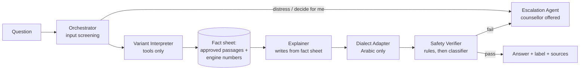

# Responsible AI

The Merros Genetic Copilot explains results, conditions, chances and options. It is built so that a language model can make the wording natural but cannot change the facts, compute a risk, or steer a decision.

## Pipeline (`lib/ai/copilot.ts`)

| Agent | What it does | Guardrail |
|---|---|---|
| Orchestrator | Screens the question before any model runs. Distress and "decide for me" questions get a fixed, reviewed reply and a counsellor offer | Deterministic rules, bilingual, unit tested |
| Variant Interpreter | Chooses tools: content search, risk engine, own result, classification guide, ClinVar reference | It cannot answer the person; only tool outputs go forward. Content search always runs |
| Explainer | Writes the answer at the person's reading level | Sees only the fact sheet. Must cite passage ids |
| Cultural and Dialect Adapter | Rewrites Arabic into natural Gulf Arabic | Discarded automatically if it changes a number or a citation |
| Safety Verifier | Rules layer, then a model classifier (Education / Decision Support / prohibited) | Prohibited or failing drafts are replaced with a counsellor offer and logged |
| Escalation Agent | Records the reason and offers a session (SPEC 4.8) | Uses the same tested escalation codes as the rest of Merros |

## What the model can and cannot do

* **Numbers.** Every percentage must come from the deterministic risk engine through a tool. The Safety Verifier blocks any percentage that is not in the fact sheet, so an invented or rounded number never reaches the person (tested).
* **Grounding.** Answers are written from approved content with ids, versions and sources. An answer with no valid citation is blocked (tested).
* **Non directive.** Directive, stigmatising and diagnostic wording is blocked in English and Arabic, for example "you should not marry", "the right choice is", "bad genes", "defective", "your baby will have" and their Arabic equivalents (tested with allowed and blocked examples).
* **Labels.** Every answer carries Education or Decision Support. The Copilot can never produce Clinical Advice; that label exists only for named, accredited humans.
* **Fail closed.** If the classifier returns no verdict, the draft is treated as prohibited. If the provider fails, the person gets a calm message, not an error or a guess.

## Privacy

* The model receives the question, the reading level, the language and gene level findings (gene, classification, condition). It never receives names, ids, dates, contact details or the partner's result. A unit test inspects everything passed to the provider.
* Conversation text is not stored. The guard log (`GuardEvent`) records only which rule fired, the stage, the action and the language.
* The audit log records that a question was asked and its label, not its content.

## Providers (`lib/ai/provider.ts`)

| `AI_PROVIDER` | What runs | Notes |
|---|---|---|
| `mock` (default) | Offline provider: composes approved passages and engine numbers with keyword routing | No key, no network. Marked "Offline demo model" in the interface. Used in CI |
| `anthropic` | Claude through the Anthropic API (`AI_MODEL`, default `claude-opus-5-5`; `AI_API_KEY`; optional `AI_ENDPOINT`) | Tool use with strict schemas for the Interpreter, structured output for the classifier, server side fallbacks enabled for safety classifier declines |

Planned: Claude through Microsoft Foundry on Azure (UAE North deployment, Phase 4). Jais, an Arabic first model, is a candidate for the Dialect Adapter and will be evaluated on the Arabic half of the golden set before any use.

Prompts are versioned in `lib/ai/prompts/` (current: v1) and the version is printed in every evaluation report.

## Evaluation

`pnpm eval` runs the golden set (`eval/golden.jsonl`, 54 bilingual questions, draft v0) through the pipeline and writes `docs/AI_EVALUATION.md`. It scores factual accuracy against the risk engine, non directiveness, citation presence, correct escalation, correct label, readability and answer language. CI runs it with the offline provider and fails on any safety failure.

## Known limits

* The golden set and the Safety Verifier phrase lists are a first draft and need review by a genetic counsellor and native Gulf Arabic reviewers. Rule lists cannot catch every harmful phrasing, which is why the classifier, the grounding checks and human escalation sit alongside them.
* The offline provider is not a language model. Its evaluation measures the pipeline, not conversational quality. Claude has not yet been evaluated on the golden set in this repository, because no API key was configured.
* Retrieval is lexical. Embedding retrieval with pgvector is the production upgrade.
* Voice (Gulf Arabic speech) arrives in Phase 4.
